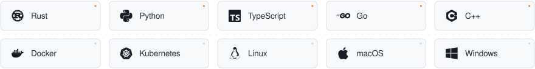

  <picture>
    <source media="(prefers-color-scheme: dark)" srcset="./assets/gargantua-dark.svg" />
    <source media="(prefers-color-scheme: light)" srcset="./assets/gargantua-light.svg" />
    
  </picture>

<h3 align="center">RoggeOhta</h3>

  <strong>AI Principal Engineer &amp; Founder</strong> 
  Building agentic harnesses, Rust systems, and local AI inference. 
  Favoring composition-first architecture, clear boundaries, and measurable craft · <a href="mailto:roggeohta@outlook.com">roggeohta@outlook.com</a>

  <picture>
    <source media="(prefers-color-scheme: dark)" srcset="./assets/stack-dark.svg" />
    <source media="(prefers-color-scheme: light)" srcset="./assets/stack-light.svg" />
    
  </picture>

