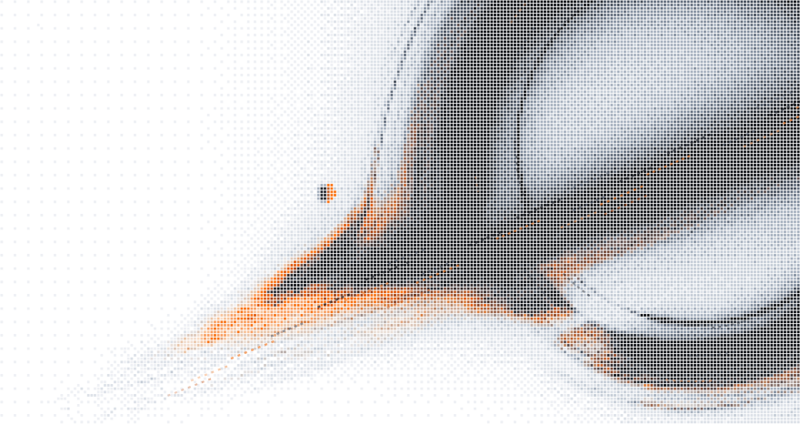

  <picture>
    <source media="(prefers-color-scheme: dark)" srcset="./assets/gargantua-dark.svg" />
    <source media="(prefers-color-scheme: light)" srcset="./assets/gargantua-light.svg" />
    
  </picture>

<h3 align="center">RoggeOhta</h3>

  <strong>AI Principal Engineer &amp; Founder</strong> 
  Building agentic harnesses, Rust systems, and local AI inference. 
  Favoring composition-first architecture, clear boundaries, and measurable craft · <a href="mailto:roggeohta@outlook.com">roggeohta@outlook.com</a>

  <picture>
    <source media="(prefers-color-scheme: dark)" srcset="https://skillicons.dev/icons?i=rust,py,ts,js,go,cpp,c,kotlin,haskell,bash,wasm,lua,bun,nodejs,deno,pytorch,tensorflow,sklearn,opencv,fastapi,flask,tauri,electron,react,nextjs,vue,vite,tailwind,graphql,threejs,postgres,redis,sqlite,mongodb,kafka,docker,kubernetes,linux,cloudflare,aws,gcp,nginx,githubactions,git,neovim&perline=15&theme=dark" />
    <source media="(prefers-color-scheme: light)" srcset="https://skillicons.dev/icons?i=rust,py,ts,js,go,cpp,c,kotlin,haskell,bash,wasm,lua,bun,nodejs,deno,pytorch,tensorflow,sklearn,opencv,fastapi,flask,tauri,electron,react,nextjs,vue,vite,tailwind,graphql,threejs,postgres,redis,sqlite,mongodb,kafka,docker,kubernetes,linux,cloudflare,aws,gcp,nginx,githubactions,git,neovim&perline=15&theme=light" />
    
  </picture>

